<p align="center">
  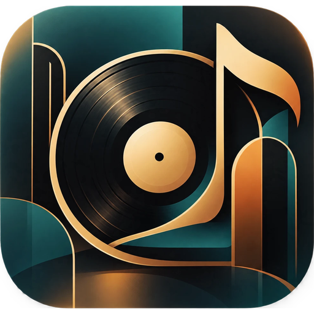
</p>

<h1 align="center">HOLOWAVE</h1>

<p align="center">
  <b>Le salon d'écoute hors ligne.</b><br>
  Un lecteur de musique Android façon jazz-bar Art Déco, avec paroles synchronisées.
</p>

<p align="center">
  <a href="https://github.com/0x80070006/holowave-deco/releases/latest/download/HOLOWAVE.apk"></a>
</p>

<p align="center">
  
  
  
  
  
</p>

<p align="center">
  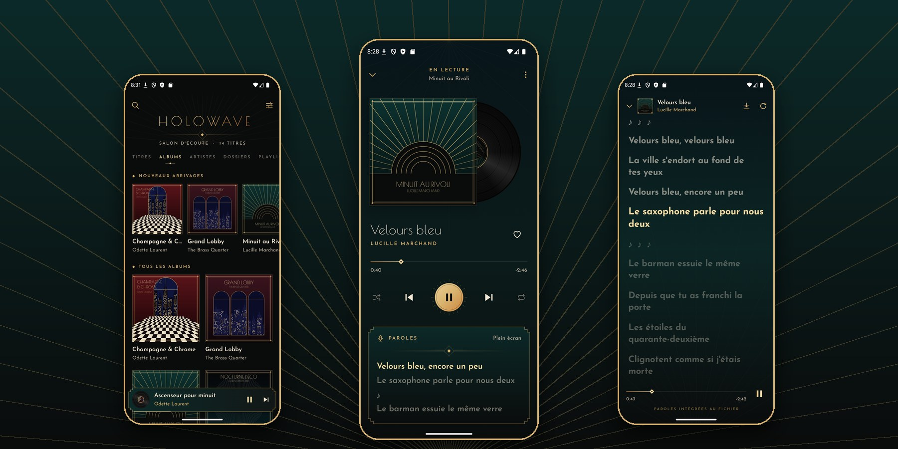
</p>

---

HOLOWAVE lit la musique **stockée sur votre téléphone** : pas de compte, pas de streaming, pas de pub. L'interface emprunte aux bars à cocktails des années 1930 : laiton, velours, sarcelle profonde, motifs en soleil et coins à redans. La pochette de l'album glisse hors de son étui et le vinyle se met à tourner quand la musique démarre.

La version 2 est une refonte complète de l'[ancienne HoloWave](https://github.com/0x80070006/HoloWave) (Flutter, thème cyberpunk), réécrite en natif Kotlin.

## Fonctionnalités

**Lecture**
- Discothèque locale indexée via MediaStore, par **albums, artistes, dossiers, titres** et **playlists**
- **Dossiers sources** : ajoutez manuellement les dossiers de votre choix (sélecteur Android) ou cochez-les dans l'arborescence détectée, sous-dossiers inclus, mémoire interne et carte SD
- **Vraie recherche des morceaux** avec barre de progression : HOLOWAVE parcourt les dossiers et fait indexer par Android les fichiers audio qu'il n'avait pas encore repérés, ou seulement à moitié. Ça règle le cas classique des morceaux copiés qui n'apparaissent nulle part.
- Recherche instantanée (insensible aux accents)
- File d'attente : *lire ensuite*, *ajouter à la file*, aléatoire, répétition (file / titre)
- **Coups de cœur** et playlists, sauvegardés sur l'appareil

**Paroles synchronisées, comme sur Spotify, mais hors ligne**
- Défilement en temps réel, ligne active en doré ; un tap sur une ligne y amène la lecture
- Si vous faites défiler à la main, le suivi automatique se met en pause, puis reprend tout seul
- Les sources sont essayées dans cet ordre, en commençant par l'appareil :
  1. fichier **.lrc importé** par vous
  2. paroles **intégrées au fichier audio** (ID3 `USLT`/`TXXX` pour le MP3, commentaires Vorbis pour le FLAC)
  3. **cache local** des paroles déjà téléchargées
  4. **[LRCLIB](https://lrclib.net)**, une base de paroles libre et ouverte, sans compte ni clé d'API. Ce qui est trouvé est gardé pour la suite, hors ligne.
- Bouton « Tout préparer » pour télécharger d'avance les paroles de toute la discothèque

**En veille et sur l'écran de verrouillage**
- La lecture continue écran éteint (service de premier plan Media3)
- Le lecteur système, dans le volet de notifications et sur l'écran de verrouillage, affiche la **jaquette Art Déco** (pochette et vinyle) teintée à la **couleur de l'album**, avec une **piste de lecture glissable**, les boutons précédent / lecture / suivant et un bouton **coup de cœur**
- Casque, Bluetooth et commandes système sont pris en charge ; la lecture se met en pause si le casque est débranché

## Captures

| Bibliothèque | En lecture | Paroles |
|:---:|:---:|:---:|
| 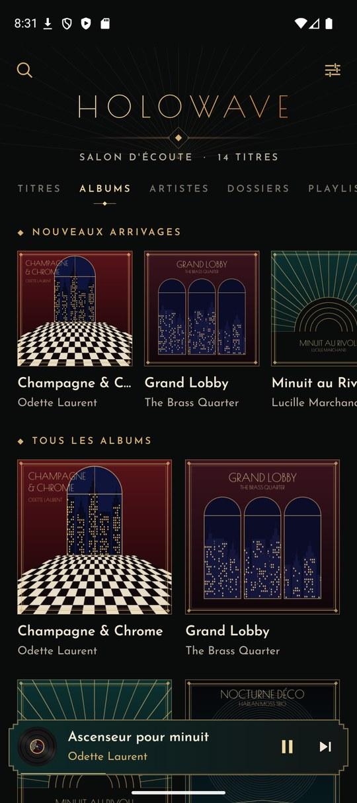 | 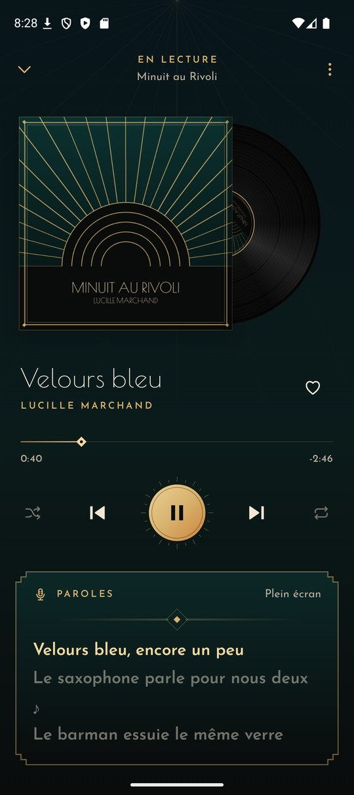 | 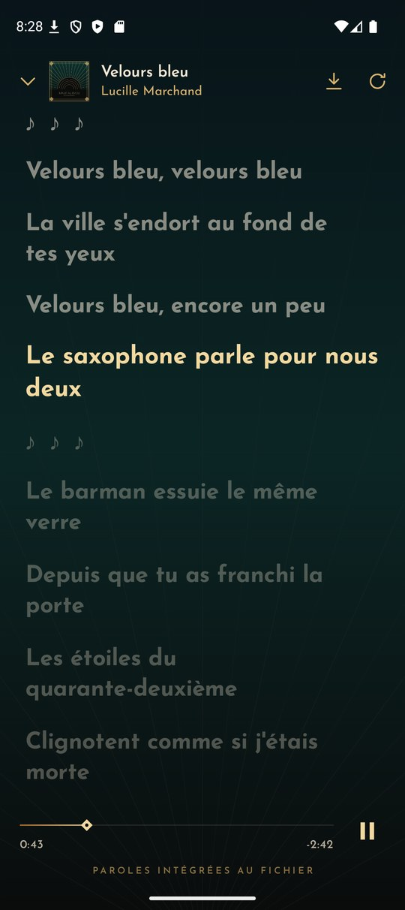 |
| **Album** | **Écran de verrouillage** | **Notification** |
| 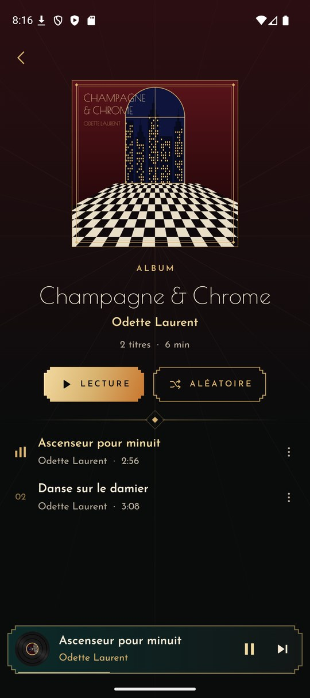 | 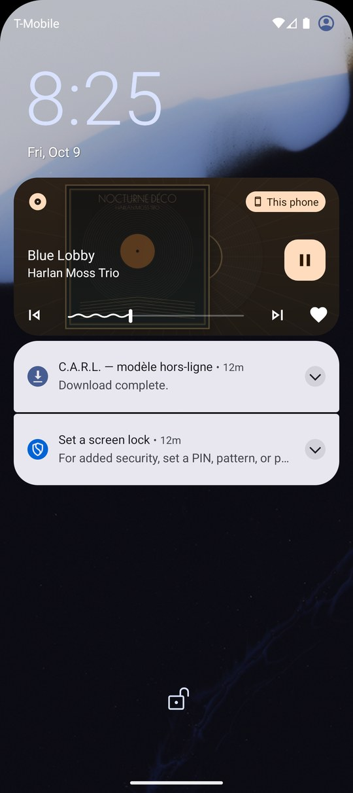 | 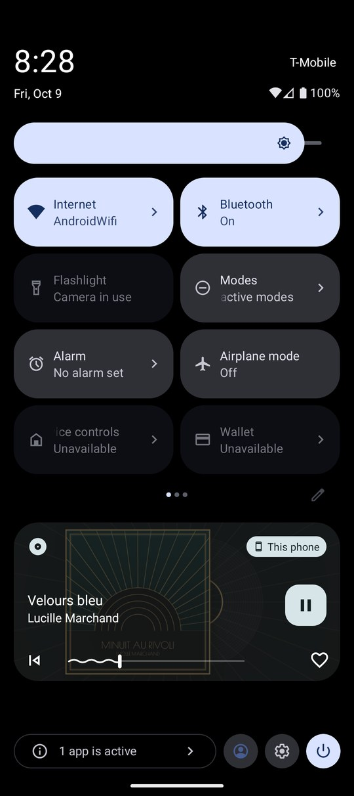 |
| **Titres** | **Artistes** | **Actions** |
| 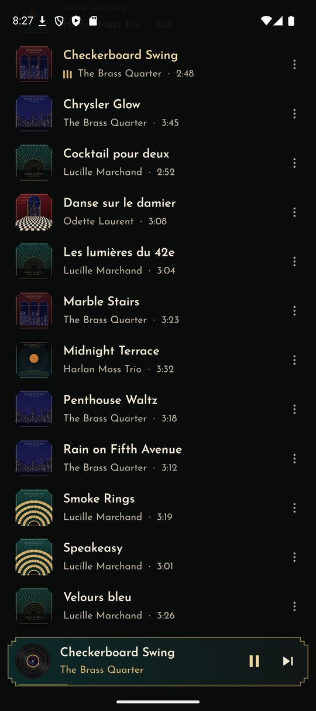 | 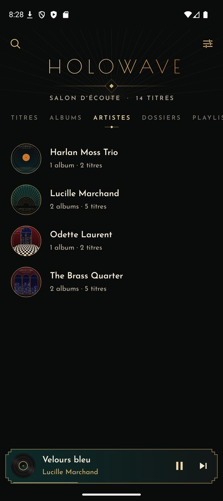 | 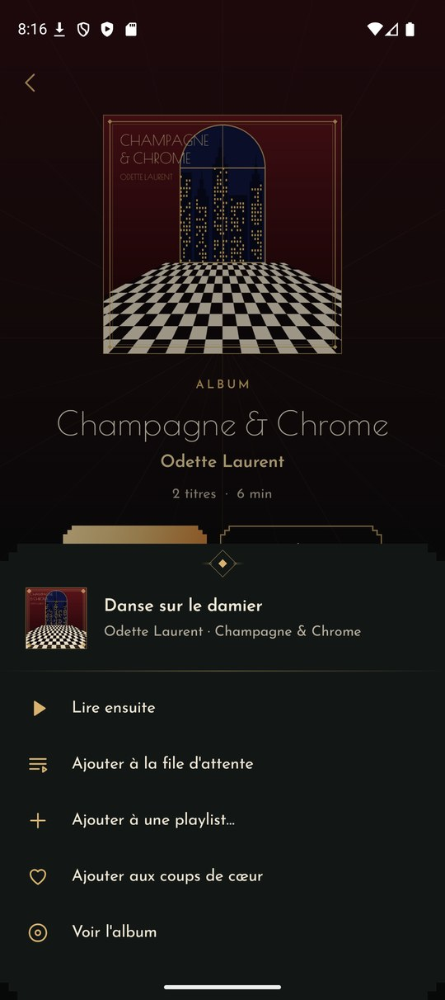 |
| **Réglages** | **Dossiers sources** | **Premier lancement** |
| 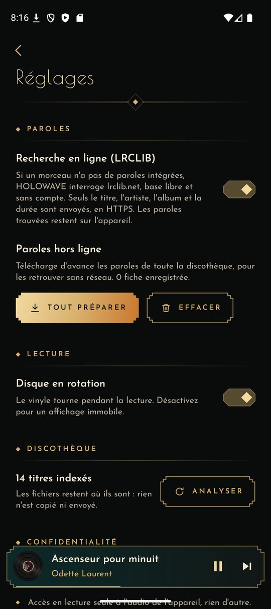 | 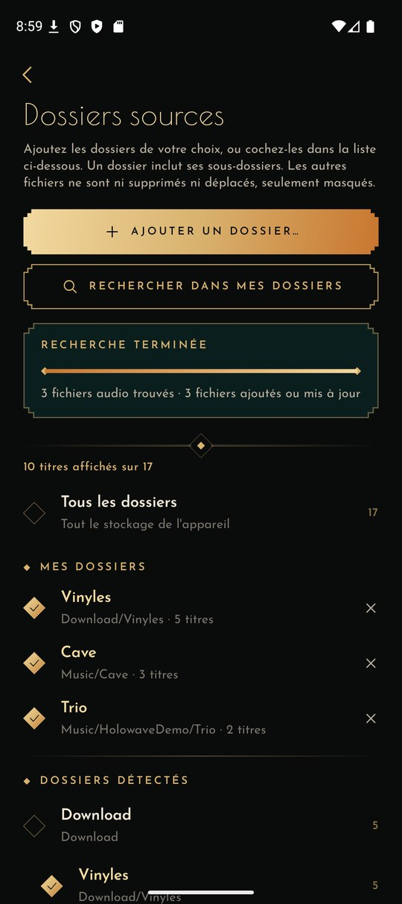 | 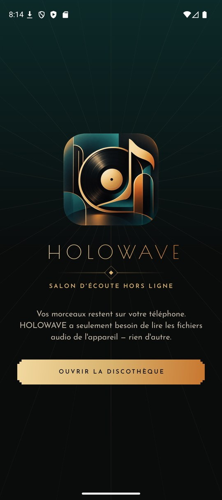 |

> La discothèque des captures est fictive : artistes, pochettes, musiques et paroles ont été créés pour la démo.

## Sécurité et vie privée

L'app est pensée pour être sûre par défaut (*secure by design*) :

| | |
|---|---|
| **Permissions minimales** | lecture de l'audio (`READ_MEDIA_AUDIO`), notifications, service de lecture. Pas d'accès aux photos, aux contacts, à la localisation ni à l'ensemble des fichiers (`MANAGE_EXTERNAL_STORAGE` n'est pas demandé). Les dossiers ajoutés à la main passent par le sélecteur Android : accès **en lecture seule**, limité à ces dossiers, et rendu à Android quand vous retirez le dossier. |
| **Réseau** | Une seule destination possible : `lrclib.net`, en HTTPS, et la fonction se désactive dans les réglages. Le trafic en clair est interdit et seules les autorités de certification du système sont acceptées (les CA ajoutées par l'utilisateur sont refusées, ce qui bloque l'interception). Les réponses sont plafonnées à 1 Mo, avec des délais d'attente stricts. |
| **Données envoyées** | Titre, artiste, album et durée du morceau, rien d'autre. Aucun identifiant ni statistique. |
| **Stockage** | Playlists, favoris et paroles restent dans l'espace privé de l'app et sont **exclus des sauvegardes cloud** et des transferts d'appareil. Les écritures sont atomiques (`AtomicFile`). |
| **Composants exportés** | L'activité de lancement, et le service média, qui **refuse tout contrôleur non approuvé** (seuls l'app, l'interface système, le Bluetooth et la plateforme sont acceptés). Tous les `PendingIntent` sont immuables. |
| **Fichiers hostiles** | Le lecteur de tags ID3/FLAC et le parseur LRC sont écrits à la main, sans bibliothèque tierce. Chaque taille est vérifiée avant toute allocation, et des tests couvrent les cas tronqués ou malveillants. |
| **Surface réduite** | Aucune WebView, aucun chargement de code dynamique, aucun SDK tiers en dehors d'AndroidX et Media3. R8 est activé en release et les métadonnées de dépendances sont retirées de l'APK. |

## Installation

1. Téléchargez **[HOLOWAVE.apk](https://github.com/0x80070006/holowave-deco/releases/latest/download/HOLOWAVE.apk)** depuis les [releases](https://github.com/0x80070006/holowave-deco/releases).
2. Ouvrez-le sur votre téléphone (autorisez l'installation depuis cette source si Android le demande).
3. Au premier lancement, autorisez l'accès à « Musique et audio ».

Mettez vos fichiers (MP3, FLAC, M4A, OGG, WAV…) dans le dossier **Musique** du téléphone : ils apparaissent automatiquement. Pour n'afficher que certains dossiers, allez dans **Réglages → Dossiers sources**, puis **Ajouter un dossier…**. Si des morceaux manquent, lancez **Rechercher** : la barre indique les dossiers parcourus, les fichiers trouvés, puis l'indexation.

**Astuce paroles :** pour avoir les paroles sans jamais toucher au réseau, intégrez-les dans vos fichiers (avec [Mp3tag](https://www.mp3tag.de/) ou [MusicBrainz Picard](https://picard.musicbrainz.org/)), ou importez un `.lrc` depuis l'écran des paroles.

## Compiler

Prérequis : JDK 17+ (le JBR d'Android Studio convient) et le SDK Android 37.

```bash
./gradlew assembleDebug          # APK de debug
./gradlew testDebugUnitTest      # tests unitaires (LRC, ID3/FLAC, playlists, dossiers sources)
./gradlew assembleRelease        # APK signé si keystore.properties est présent
```

Pour signer en release, créez un `keystore.properties` à la racine (il est ignoré par git) :

```properties
storeFile=holowave-release.jks
storePassword=…
keyAlias=holowave
keyPassword=…
```

## Architecture

```
app/src/main/java/io/github/x80070006/holowave/
├── HolowaveApp.kt            conteneur de dépendances (manuel, sans réflexion)
├── MainActivity.kt           permissions + point d'entrée Compose
├── data/                     MediaStore, dossiers sources, playlists (JSON atomique), réglages, pochettes
├── lyrics/
│   ├── Lrc.kt                parseur LRC (horodatages multiples, offset, « enhanced »)
│   ├── EmbeddedLyrics.kt     lecture des paroles ID3v2.3/2.4 et FLAC
│   ├── LrcLibClient.kt       client HTTPS LRCLIB, réponses plafonnées
│   └── LyricsRepository.kt   résolution hors ligne d'abord, puis cache
├── playback/
│   ├── PlaybackService.kt    MediaSessionService : veille, notification, écran de verrouillage
│   ├── NotificationArt.kt    jaquette Art Déco pour le lecteur système
│   └── PlayerConnection.kt   MediaController exposé en StateFlow
└── ui/
    ├── theme/                palette, typographie, icônes dessinées à la main
    ├── components/           vinyle, ornements, mini-lecteur, listes, feuilles
    └── screens/              bibliothèque, album, lecteur, paroles, réglages
```

**Pile technique :** Kotlin, Jetpack Compose (Material 3 réduit au minimum, composants dessinés sur mesure), AndroidX Media3 (ExoPlayer et MediaSession), `org.json` de la plateforme. Aucune autre dépendance.

## Crédits

- Paroles en ligne : [LRCLIB](https://lrclib.net), base libre et communautaire
- Polices : [Poiret One](https://fonts.google.com/specimen/Poiret+One) et [Josefin Sans](https://fonts.google.com/specimen/Josefin+Sans), sous licence SIL Open Font License (voir [`licenses/`](licenses))
- Lecture audio : [AndroidX Media3](https://github.com/androidx/media)

## Licence

Code sous licence [MIT](LICENSE).
